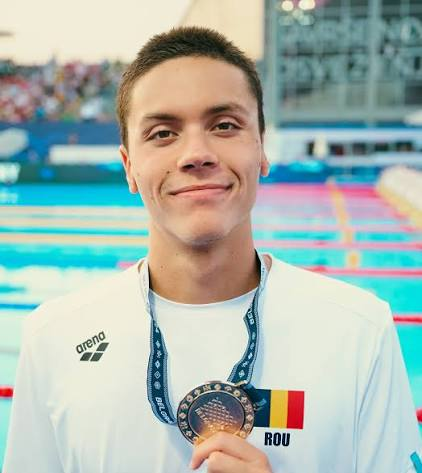

I love swimming because it gives me a chance to focus, challenge myself and feel refreshed all at once. Whether I am doing a few relaxed lengths or working on my pace, being in the water helps me clear my head and enjoy the moment.

One of my favourite things about swimming is that there is always something new to improve. I can work on my technique, build stamina or simply try to make each length a little smoother than the last. Progress takes patience, which makes every small improvement feel rewarding.

My favourite swimmer is David Popovici. I admire his speed and his dedication, and I find it exciting to watch the way he races. Seeing an athlete perform at that level inspires me to keep practising and enjoy getting better at my own pace.

For me, swimming is more than exercise. It is a hobby that brings me joy, helps me stay active and gives me something to look forward to. I hope to keep swimming for a long time—and I will definitely keep cheering for David Popovici.
